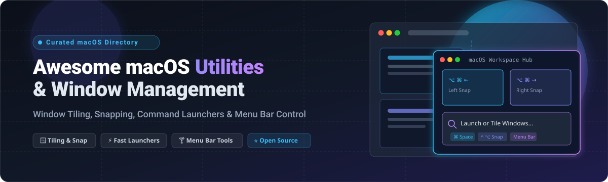

  

# 🍏 Awesome macOS Utilities & Window Management 🪟⚡

  
  
  
  
  
  

> 🚀 **A curated, battle-tested directory of the best macOS utilities, window managers, command launchers, tiling engines, and menu bar managers for Mac power users, developers, and productivity enthusiasts.**

---

## 📌 Table of Contents 📑
- [📊 Sector Overview & Market Dynamics](#-sector-overview--market-dynamics)
- [💼 Commercial & SaaS Platforms](#-commercial--saas-platforms)
- [⭐ Open-Source GitHub Projects](#-open-source-github-projects)
- [🛠️ Recommended Workflow Recipes](#️-recommended-workflow-recipes)
- [💖 Support & Sponsorship](#-support--sponsorship)
- [🤝 How to Contribute](#-how-to-contribute)
- [📈 Star History](#-star-history)
- [⚖️ Disclaimer & Security Notice](#️-disclaimer--security-notice)

---

## 📊 Sector Overview & Market Dynamics 📈

The desktop productivity utilities and window management market represents an estimated **$1.8B to $2.5B global addressable sector** within the wider personal and developer software ecosystem. 

This sector is **moderately fragmented**: baseline window-snapping and screen-tiling utilities are distributed across numerous lightweight indie tools, while extensible AI-integrated application launchers (such as Raycast) and ecosystem bundles (such as Setapp) are exhibiting winner-take-most compounding network effects driven by modular third-party extension ecosystems and enterprise cross-platform expansion.

---

## 💼 Commercial & SaaS Platforms 🏷️

A definitive comparison of leading commercial macOS window management, screen capture, and workflow utilities. Ranked descending by company valuation / estimated revenue scale.

| 💻 Product | 🏢 Company Scale / Valuation / ARR | 💵 Pricing (Starting Tier) | 🎁 Free Tier Limit / Free Trial Plan | 🎯 Key Focus & Capabilities |
| :--- | :--- | :--- | :--- | :--- |
| **[Raycast](https://www.raycast.com/)** | **~$200M Valuation** (Series B funded, $47.8M raised; ~$5M-$10M ARR) | **$10/mo** (billed annually at $96/yr for Pro) | **Free forever plan**: Core launcher, extensions & window management; 3-month clipboard history, 5 notes max, 0 AI credits | Extensible command launcher, scriptable workflow engine, built-in window snapping, and AI assistant |
| **[CleanShot X](https://cleanshot.com/)** | **~$5M - $10M ARR** (Top-tier Mac indie software powerhouse) | **$35 one-time** (Basic for 1 Mac) or **$10/user/mo** (Pro Cloud) | **30-day money-back guarantee**; or **7-day free trial** via Setapp subscription (Basic plan includes 1 GB cloud storage) | Industry-standard screen capture, scrolling OCR capture, video recording, screen markup & cloud upload |
| **[Bartender](https://www.macbartender.com/)** | **~$1M - $3M ARR** (Bootstrapped indie, acquired by aplos.io) | **$20.40 one-time** (or $5.10 upgrade license) | **28-day free trial**: Unrestricted access to all menu bar grouping, hiding, search and trigger features | Clutter-free menu bar manager with sub-bars, auto-triggers, notch support, and quick search |
| **[Alfred](https://www.alfredapp.com/)** | **~$1M - $2.5M ARR** (Running with Millions of active users since 2010) | **£40 one-time** (Single License for 2 Macs) or **£70** (Mega Supporter) | **Free forever plan**: Basic app launching, local file search, calculator, system commands & web queries (Powerpack unlocks Workflows & Clipboard) | Veteran keyboard productivity app, hotkeys, snippets, and modular automation workflows |
| **[Magnet](https://magnet.crowdcafe.com/)** | **~$800K - $1.5M ARR** (CrowdCafe, long-running #1 Mac App Store utility) | **$4.99 one-time** (Mac App Store purchase) | **No free trial**: Upfront paid App Store purchase with Family Sharing up to 6 members | Sandboxed window snapping via drag-to-edge zones, edge-halves, quarters, and keyboard shortcuts |
| **[Rectangle Pro](https://rectangleapp.com/pro)** | **~$500K - $1M ARR** (Independent developer Ryan Hanson) | **$9.99 one-time** (Lifetime license for up to 3 personal Macs) | **10-day free trial**: Fully unlocked features including custom snap areas, window throws, and saved multi-display layouts | Enhanced window management with cursor throws, saved monitor workspace layouts, and custom snapping areas |
| **[Moom](https://manytricks.com/moom/)** | **~$300K - $700K ARR** (Many Tricks independent software studio) | **$15 one-time** ($8 upgrade license, lifetime ownership) | **100 "Mooms" usage-based trial**: 100 free window move/resize operations without time restrictions | Zoom button integration, visual grid snapping, and multi-monitor display layout snapshots |
| **[Mosaic](https://www.lightpillar.com/mosaic.html)** | **~$200K - $500K ARR** (Light Pillar software studio) | **£14.99 one-time** (Core License) | **7-day free trial**: Completely unrestricted access to drag-and-drop grids and multi-monitor layouts | Flexible drag-and-drop window layout organizer with customizable layouts and Touch Bar support |
| **[Divvy](https://mizage.com/divvy/)** | **~$150K - $350K ARR** (Mizage LLC) | **$14.00 one-time** (macOS or Windows standalone license) | **Free evaluation trial**: Fully functional grid interface trial with occasional registration reminder prompts | Rapid grid-based window layout drawing and shortcut assignments |

---

## ⭐ Open-Source GitHub Projects 🔓

Curated list of community-driven, transparent, and telemetry-free macOS window managers, menu bar organizers, and desktop utilities. Sorted by GitHub star count in descending order.

| 📦 Repository & Project | ⭐ GitHub Stars | 🏷️ Category | 📝 Description |
| :--- | :--- | :--- | :--- |
| **[Rectangle](https://github.com/rxhanson/Rectangle)** |  | 🪟 Window Snapping | Move and resize windows on macOS with customizable keyboard shortcuts and mouse snap areas. Lightweight, battle-tested, and requires zero SIP changes. |
| **[Ice](https://github.com/jordanbaird/Ice)** |  | 🍸 Menu Bar Organizer | Powerful, native menu bar manager for macOS. Hide, show, and organize menu bar icons with Ice Bar, hotkeys, custom appearance, and MacBook notch support. |
| **[yabai](https://github.com/koekeishiya/yabai)** |  | 🧱 Tiling WM | High-performance tiling window manager for macOS using binary space partitioning (BSP). Scriptable via CLI client and pairs seamlessly with hotkey daemons. |
| **[AeroSpace](https://github.com/nikitabobko/AeroSpace)** |  | 🪟 i3-like Tiling WM | i3-inspired tiling window manager for macOS with tree-based automatic tiling and virtual workspaces that seamlessly bypass native macOS Spaces limitations. |
| **[AltTab](https://github.com/lwouis/alt-tab-macos)** |  | 🔀 App Switcher | Brings the power and convenience of Windows-style Alt-Tab window switcher to macOS, featuring live thumbnails, shortcuts, and multi-display filters. |
| **[Hammerspoon](https://github.com/Hammerspoon/hammerspoon)** |  | ⚙️ Automation & WM | Staggeringly powerful desktop automation bridge exposing macOS system APIs (windows, screens, audio, network, events) to high-speed Lua scripts. |
| **[Amethyst](https://github.com/ianyh/Amethyst)** |  | 📐 Automatic Tiling WM | Automatic tiling window manager for macOS inspired by xmonad. Cycles dynamically through tall, wide, column, and fullscreen layouts as windows open and close. |
| **[Hidden Bar](https://github.com/dwarvesf/hidden)** |  | 🍸 Menu Bar Hider | Ultra-lightweight macOS utility designed to hide extra status icons in the menu bar with click or keyboard triggers. |
| **[Loop](https://github.com/MrKai77/Loop)** |  | 🎯 Radial Snapper | Next-generation window management with a sleek radial gesture menu. Hold a modifier key and nudge the cursor to snap windows into halves, thirds, and quadrants. |
| **[skhd](https://github.com/koekeishiya/skhd)** |  | ⌨️ Hotkey Daemon | Simple, blazingly fast hotkey daemon for macOS with modal hotkeys and concise DSL syntax. The standard shortcut driver for yabai and CLI setups. |
| **[ShiftIt](https://github.com/fikovnik/ShiftIt)** |  | 🪟 Classic Snapper | The classic open-source window organizer that pioneered keyboard-driven quadrant and half-screen positioning on macOS. |
| **[Phoenix](https://github.com/kasper/phoenix)** |  | 📜 Scriptable WM | Ultra-lightweight, customizable macOS window and application manager fully scriptable via modern JavaScript / TypeScript. |
| **[OmniWM](https://github.com/OmniNull/OmniWM)** |  | 🌀 Scrolling & Dwindle WM | Modern tiling window manager tailored for Apple Silicon Macs, implementing Niri-style scrolling containers and Hyprland-style Dwindle binary partitioning. |
| **[BetterShot](https://github.com/KartikLabhshetwar/better-shot)** |  | 📸 Capture & Annotate | Native SwiftUI screenshot and screen recording tool with 75+ hotkeys, scrolling capture, OCR, video editor, and self-hosted Cloudflare R2 bucket integration. |
| **[Look](https://github.com/kunkka19xx/look)** |  | 🔍 Spotlight / Raycast Alt | Privacy-respecting, community-driven cross-platform command palette and quick launcher with local-first indexation and zero telemetry. |
| **[Ice (cavaldos fork)](https://github.com/cavaldos/Ice)** |  | 🍸 Menu Bar Extended | Actively maintained fork of Ice featuring extended macOS release compatibility, custom item profiles, and enhanced multi-display stability. |
| **[Floe](https://github.com/wudb/Floe)** |  | 🍸 Menu Bar Suite | Clean, open-source macOS menu bar manager supporting visible/hidden/always-hidden sections, layout recovery, and direct profile migration from Bartender. |
| **[Wrangler](https://github.com/jgaddis99/wrangler)** |  | 📐 Grid Tiler | Window manager built for multi-display setups, featuring configurable grid layouts, batch-tiling for development windows, and visual snap overlays. |

---

## 🛠️ Recommended Workflow Recipes 🧩

Need inspiration for a unified, keyboard-centric Mac setup? Here are top modular combinations:

* **The Minimalist Free Stack:** `Rectangle` (window snapping) + `Ice` (menu bar tidy) + `AltTab` (quick switching)
* **The Hacker / Linux Tiling Stack:** `AeroSpace` or `yabai + skhd` + `Look` (launcher) + `Hammerspoon` (automation)
* **The Modern Power User Stack:** `Raycast` (launcher & AI) + `Rectangle Pro` or `Loop` (snapping) + `BetterShot` (screen recording)

---

## 💖 Support & Sponsorship ☕

Thank you so much for using and exploring this curated macOS utility collection! Maintaining up-to-date documentation, vetting new releases, and verifying ecosystem tools takes continuous time and care. 

If this project made your Mac workflow smoother, faster, or saved you hours of searching:
- ⭐ **Star this repository** to help other developers find it.
- 🍴 **Fork and contribute** your favorite missing tools or updates.
- 📢 **Share** it with your engineering team, design peers, or Mac communities.
- ☕ **Support the author**: If you'd like to buy me a coffee or support ongoing open-source maintenance, please consider sponsoring via the [GitHub Sponsors Dashboard](https://github.com/sponsors/ishandutta2007). Your support is deeply appreciated!

---

## 🤝 How to Contribute ✨

1. 🍴 Fork the repository.
2. 🌿 Create a feature branch (`git checkout -b feature/cool-utility`).
3. 📝 Add your utility or project matching the existing tabular format and star badge convention.
4. 🚀 Open a Pull Request with a clear description and links.

---

##  Star History
#

---

## ⚖️ Disclaimer & Security Notice 🛡️

* All product names, logos, and brands are property of their respective owners.
* macOS window managers and menu bar tools utilize accessibility APIs and screen recording permissions. Ensure you only install applications from trusted sources.
* Star counts and pricing plans reflect current live metrics and may vary over time.

---

  <b>⭐ Found this helpful? Star this repo to keep it visible for macOS developers worldwide! ⭐</b>

